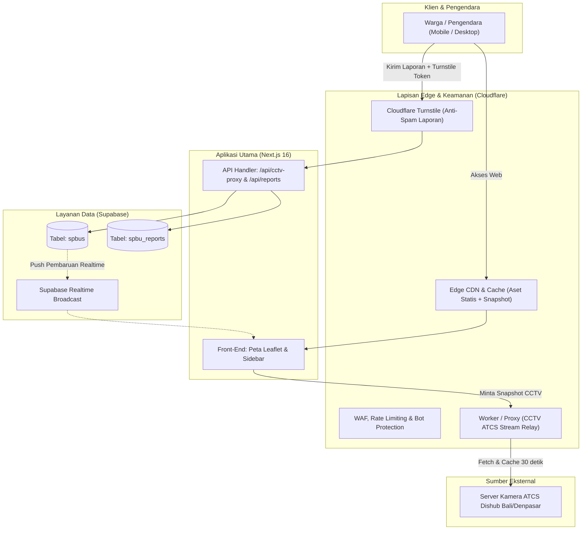

# RANCANGAN IMPLEMENTASI (IMPLEMENTATION PLAN)
## Proyek: Live SPBU Bali (Denpasar & Badung)
**Integrasi Database Supabase, Keamanan & Caching Cloudflare, serta Peningkatan Fitur**

---

### 1. Ringkasan Eksekutif & Tujuan

Tujuan dari rencana implementasi ini adalah mentransformasi **Live SPBU Bali** dari prototipe lokal (*localStorage*) menjadi platform publik yang siap produksi (*production-ready*), tahan terhadap lonjakan ribuan pengunjung saat krisis BBM, memiliki validasi data pelaporan anti-spam, serta menyajikan pemantauan visual CCTV ATCS yang stabil.



---

### 2. Fase-Fase Implementasi

---

#### FASE 1: Integrasi Database & Realtime Supabase
**Fokus:** Menghubungkan aplikasi ke cloud database agar data antrean dan stok BBM tersinkronisasi antar-pengguna secara langsung.

1. **Konfigurasi Environment Proyek**
   - Membuat file `.env.local` untuk development dan menyetel konfigurasi produksi.
   - Variabel yang dibutuhkan:
     ```env
     NEXT_PUBLIC_SUPABASE_URL=https://<project-ref>.supabase.co
     NEXT_PUBLIC_SUPABASE_ANON_KEY=<anon-key>
     ```

2. **Penyusunan Skema Database SQL (`schema.sql`)**
   - **Tabel `spbus`**: Menyimpan master data SPBU (kode, nama, lokasi koordinat, kecamatan, kabupaten, status stok BBM, level antrean, perkiraan waktu tunggu, dan info CCTV).
   - **Tabel `spbu_reports`**: Riwayat laporan crowdsourcing dari warga untuk keperluan audit dan histori.
   - **Row Level Security (RLS)**:
     - `spbus`: Publik dapat membaca (`SELECT`), pembaruan status (`UPDATE`) diizinkan untuk kolom antrean/stok melalui fungsi aman atau anon policy terbatas.
     - `spbu_reports`: Publik dapat menyisipkan data (`INSERT`).

3. **Seeding Master Data Awal**
   - Mengimpor data dari `src/data/spbu-denpasar-badung.ts` ke tabel `spbus`.

4. **Pengaktifan Supabase Realtime Subscription**
   - Menambahkan listener `supabase.channel('spbus-changes')` pada `src/app/page.tsx` agar saat ada warga mengirim laporan di Denpasar, peta pengendara lain di Badung langsung ter-update secara otomatis tanpa reload.

---

#### FASE 2: Integrasi Cloudflare (Keamanan, Caching & CCTV Proxy)
**Fokus:** Menjaga ketersediaan web, mencegah spam laporan, dan meringankan beban server CCTV.

1. **Implementasi Cloudflare Turnstile (Anti-Bot Crowdsourcing)**
   - Mendaftarkan situs di dashboard Cloudflare Turnstile (mode *Managed* atau *Invisible*).
   - Memasang komponen widget Turnstile pada modal [QuickReportModal.tsx](file:///d:/01%20Projects/livespbu/src/components/Report/QuickReportModal.tsx).
   - Memvalidasi token Turnstile sebelum laporan disimpan ke Supabase guna menangkal serangan spam bot.

2. **Optimasi Caching & Reverse Proxy CCTV ATCS Dishub**
   - Membuat *Cloudflare Worker* atau menyetel *Cache Rule* pada rute `/api/cctv-proxy`:
     - **Edge Cache TTL**: 20–30 detik (agar ratusan pengguna melihat snapshot yang sama tanpa membebani server Dishub).
     - **CORS & SSL Terminator**: Mengubah feed kamera HTTP menjadi HTTPS yang aman dan tidak diblokir browser.

3. **Cloudflare WAF & Rate Limiting**
   - Menyetel batas pengiriman laporan: Maksimal 1 pengiriman per 3 menit per IP untuk mencegah manipulasi status antrean SPBU.
   - Proteksi DDoS standar Cloudflare untuk mengantisipasi lonjakan trafik viral.

---

#### FASE 3: Penyempurnaan Fitur & Navigasi Pengguna
**Fokus:** Kemudahan penggunaan langsung di jalan raya.

1. **Akurasi Jarak & Rute (Haversine & Integrasi Google Maps / Waze)**
   - Mengganti formula jarak garis lurus dengan formula **Haversine (km aktual)**.
   - Menambahkan tombol satu klik di kartu SPBU: **"Buka Navigasi"** (menuju URL `https://www.google.com/maps/dir/?api=1&destination=lat,lng`).

2. **Mekanisme Kedaluwarsa Data Otomatis (*Data Decay*)**
   - Status antrean dan stok yang dilaporkan warga otomatis kembali ke status normal/unknown jika tidak ada laporan baru dalam rentang waktu tertentu (misal: 60–90 menit), sehingga informasi tidak menyesatkan.

3. **Dukungan Progressive Web App (PWA)**
   - Menambahkan file `manifest.json`, icon splash screen, dan konfigurasi mobile meta tag agar pengendara dapat memasang aplikasi ke *Home Screen* smartphone mereka layaknya aplikasi native.

---

#### FASE 4: Deployment & Verifikasi Produksi
**Fokus:** Uji beban dan peluncuran resmi.

1. **Deploy Frontend & Konfigurasi DNS Cloudflare**
   - Menghubungkan domain ke Cloudflare (Nameservers).
   - Deploy aplikasi Next.js ke platform hosting (Vercel atau Cloudflare Pages).
2. **Stress & Latency Testing**
   - Uji respon waktu muat peta saat diakses dari jaringan seluler 4G/5G di Bali.
3. **Checklist Go-Live**:
   - [ ] SSL/TLS Full (Strict) aktif di Cloudflare.
   - [ ] Koneksi Supabase aktif (`isSupabaseConfigured === true`).
   - [ ] Realtime channel berjalan normal.
   - [ ] Turnstile memblokir request tanpa captcha token.
   - [ ] Proxy CCTV mengembalikan snapshot/stream yang stabil.

---

### 3. Matriks Milestone & Estimasi Pengerjaan

| Milestone | Tugas Utama | Target Output |
| :--- | :--- | :--- |
| **M1: Database Setup** | Skrip SQL skema tabel, RLS policy, & data seed ke Supabase | Database aktif & terisi 20+ SPBU |
| **M2: Integrasi App** | Koneksi `.env.local`, hook query Supabase, & Realtime Listener | Web sync data antar-perangkat secara realtime |
| **M3: Proteksi & Cloudflare** | Setup Cloudflare DNS, Turnstile di form laporan, & Edge Caching CCTV | Laporan bebas bot & CCTV ter-cache di edge |
| **M4: Peningkatan UX & PWA** | Haversine distance, direct Google Maps link, & PWA manifest | Navigasi akurat & mudah dipasang di HP |
| **M5: Rilis & Pengujian** | Pengujian di smartphone & verifikasi produksi | Aplikasi resmi siap pakai publik |

---

### 4. File-File Terkait yang Akan Ditambahkan / Diubah

- `doc/IMPLEMENTATION_PLAN.md` *(Dokumen ini)*
- `doc/schema.sql` *(Skrip skema tabel database Supabase)*
- `.env.local` *(Kredensial Supabase & Cloudflare)*
- `src/lib/supabase.ts` & `src/lib/spbu-service.ts` *(Penyempurnaan realtime subscriber)*
- `src/components/Report/QuickReportModal.tsx` *(Integrasi Cloudflare Turnstile)*
- `src/app/manifest.json` *(Dukungan PWA Mobile)*

